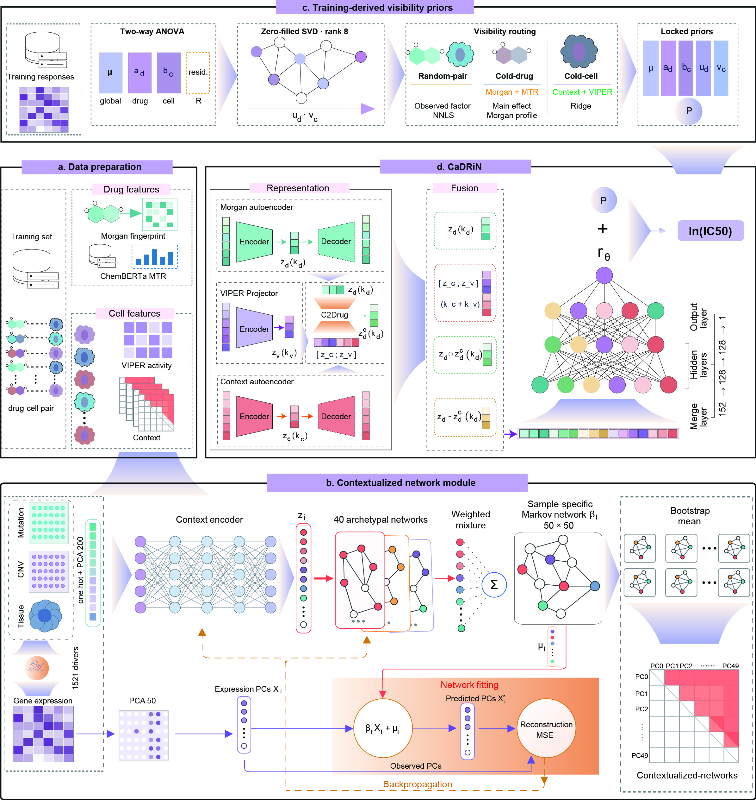

<h1 align="center">
  <a href="https://cadrin.cn/">
    
  </a>
</h1>

<p align="center">
  <strong>Predict cancer drug response through cellular regulatory context.</strong>
</p>

<p align="center">
  <a href="https://cadrin.cn/"></a>
  <a href="#quickstart"></a>
  <a href="LICENSE"></a>
</p>

<p align="center">
  <a href="https://cadrin.cn/"><strong>Open web app</strong></a>
  &nbsp; | &nbsp; <a href="#quickstart">Quickstart</a>
  &nbsp; | &nbsp; <a href="docs/usage.md">Usage guide</a>
  &nbsp; | &nbsp; <a href="docs/usage.md#training">Training</a>
</p>

**CaDRiN** predicts cancer drug response by integrating drug chemistry,
transcription factor activity and sample-specific regulatory networks. It combines
drug-conditioned cellular representations with response priors to support
prediction for observed and unseen drugs and cells.

## Model overview

<p align="center">
  <a href="docs/cadrin-model-overview.jpg?raw=true">
    
  </a>
</p>

<p align="center">
  <a href="docs/cadrin-model-overview.jpg?raw=true">View the full-resolution figure</a>
</p>

## Web application

Use **[cadrin.cn](https://cadrin.cn/)** to explore
[cell-line predictions](https://cadrin.cn/#predict),
[TCGA predictions](https://cadrin.cn/#atlas) and
[predictions for your own samples](https://cadrin.cn/#upload).
Instructions are available in the [online guide](https://cadrin.cn/#help).

## Quickstart

The repository includes a [pretrained model](examples/cadrin_pretrained_bundle.zip?raw=true)
and [example inputs](examples/data). From the repository root:

```bash
conda env create -f environment.yml
conda activate cadrin
python -m pip install .

python examples/run_example.py --bundle examples/cadrin_pretrained_bundle.zip \
  --output predictions.csv
```

Predictions are saved to `predictions.csv`. CPU is used by default;
add `--device cuda` for GPU inference.

For the Python API, custom inputs and training, see the
[usage guide](docs/usage.md).

## License and support

CaDRiN code is released under the [MIT license](LICENSE).
For questions or bug reports, open an issue in this repository.
